# AML Investigation Prioritization

**An end-to-end machine-learning case study: from synthetic transactions to a capacity-constrained investigation queue.**

> **Business question:** If investigators can review only a fixed number of account-days, can a risk-ranking model help them find more *synthetic positive labels* than selecting records at random?

[**Explore the interactive case study →**](https://mohammedmia1.github.io/AML_Data_Science_Project/) · [Walk through the project](PROJECT_GUIDE.md) · [Open the model notebook](notebooks/AML_Model_Development.ipynb) · [Download the Tableau companion](tableau/AML_Investigation_Prioritization_Dashboard.twbx)


## 01 / Decision and outcome

The model ranks **account-day records**, not people. A review policy then selects the highest-ranked records within a predefined investigation workload. The project demonstrates **ranking under a resource constraint**; it does not claim to identify confirmed financial crime.

| Held-out test metric | Result |
|:---|---:|
| Scored account-days | **494,707** |
| Review slots | **2,747 (0.555%)** |
| Synthetic positive labels in the review queue | **389** |
| Precision at capacity | **14.16%** |
| Recall of test-period positives | **25.95%** |
| Lift over random review at the same capacity | **46.73×** |
| ROC-AUC / average precision (PR-AUC) | 0.8523 / 0.1214 |

**Interpretation:** Reviewing approximately 0.56% of the held-out account-days captures approximately 26% of positive synthetic labels. Lift measures concentration relative to random selection at an equal review budget—not prevented losses, case productivity, or criminal detection in production.

## 02 / How the system fits together

```mermaid
flowchart LR
    A["Synthetic transaction data"] --> B["SQL account-day aggregation"]
    B --> C["Frozen account-day modeling TSV"]
    C --> D["Chronological train / validation / test"]
    D --> E["Logistic baseline + XGBoost ranking"]
    E --> F["Validation-defined review budget"]
    F --> G["Held-out test queue + evaluation"]
    G --> H["Interactive case study / Tableau"]
```



The **exact canonical model** is reproduced from the frozen account-day TSV. The SQL engineering script is provided and structurally reviewed, but **a raw-transactions-to-TSV rebuild has not been independently reconciled**. The diagram shows the intended analytical process, not a claim that every upstream stage was reexecuted in this release.

## 03 / Data and modeling decisions

**Unit of analysis.** An account's activity on one calendar day. The benchmark transactions and target labels are synthetic. The original account-day source file is omitted due to size; [its SHA-256, provenance and schema are documented](data/README.md).

**Chronological split.** Training: **September 1–6, 2022** (1,534,403 rows). Validation: **September 7–8** (450,244 rows). Held-out test: **September 9–10** (494,707 rows). Dates and account identifiers are used for partitioning or reporting, **not** as predictive inputs.

**Features.** Nine engineered predictors: six `log1p` transforms of transaction amounts, counts and banks, plus outgoing ratio, currency diversity and rapid-transaction ratio. [Explore the SQL transformation](sql/AML_Portfolio_Pipeline.sql) and [review model implementation](src/run_canonical.py).

**Model and policy.** A logistic-regression baseline provides a development comparator. The published final model is a fixed-configuration XGBoost classifier. A validation workload of **2,500** translates proportionally to **2,747** held-out review slots; the selected queue consists of the highest-scored account-days. Class weights use training labels only, and test results are not used to select review capacity.

**Evaluation.** Precision, recall, lift, ROC-AUC and average precision reflect different questions. Capacity-based precision and recall are central to the business decision; ROC-AUC and PR-AUC evaluate overall discrimination. See the [evaluation protocol](reports/MODEL_EVALUATION.md).

## 04 / Explore and inspect

| Resource | Why open it |
|:---|:---|
| [Interactive case study](https://mohammedmia1.github.io/AML_Data_Science_Project/) | Move a review-capacity slider and inspect the precision/recall trade-off. |
| [Project walkthrough](PROJECT_GUIDE.md) | Understand each step and its technical justification without reading every code file. |
| [Model notebook](notebooks/AML_Model_Development.ipynb) | Follow the data split, features, baseline, final model, and evaluation logic. |
| [SQL pipeline](sql/AML_Portfolio_Pipeline.sql) | Examine account-day aggregation and feature engineering. |
| [Tableau workbook](tableau/AML_Investigation_Prioritization_Dashboard.twbx) | Download the optional working `.twbx` companion (GitHub does not preview Tableau binaries). |
| [Canonical metrics](reports/metrics.json) | See exact recorded outputs and environment versions. |

## 05 / Reproduce and validate

**Full local reproduction requires the exact frozen TSV.** Python 3.13.5 and dependency versions are pinned in `requirements.txt`.

```bash
python -m pip install -r requirements.txt
# Place aml_modeling_dev.tsv in data/local/ (or set AML_INPUT_DIR)
python src/run_canonical.py
python tests/check_artifacts.py
```

`src/run_canonical.py` validates the input file checksum and produces a trained model, scored test export, metrics JSON, and the capacity curve under `artifacts/`. The repository commits only the canonical model/metrics/website artifacts, **not** the large source TSV or scored CSV.

**Without the TSV**, run `python tests/check_artifacts.py` to validate the published metrics, capacity curve, model presence and website references. GitHub Actions runs these public-artifact checks, Python compilation and notebook-JSON validation on pushes. **These checks are not equivalent to retraining the model or executing the SQL pipeline in CI.**

The notebook is provided as *reproducible source code*, not an executed notebook with stored outputs. [Read the reproducibility limits](PROJECT_GUIDE.md#verification-boundaries).

## 06 / Limitations and next steps

- **Synthetic-only:** labels do not establish confirmed criminal conduct or financial impact.
- **Short held-out period:** two test days do not establish stability under population drift.
- **Scores are rankings:** they have not been validated as calibrated probabilities.
- **Review economics unknown:** no investigator costs, analyst workload measurements or downstream case outcomes are available.
- **SQL-to-model lineage:** raw transaction aggregation needs a separate source-to-TSV reconciliation.
- **Tableau:** a working optional companion; the interactive case study is the primary verified online presentation.

**Next technical extension:** add a reproducible raw-transaction SQL test and examine stability across additional temporal holdouts—not a new claim about production AML efficacy.

---

*Portfolio demonstration using synthetic benchmark data. [Detailed project walkthrough](PROJECT_GUIDE.md) · [Source provenance](data/README.md) · [Evaluation methodology](reports/MODEL_EVALUATION.md).*
