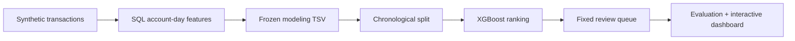

# AML Investigation Prioritization

**An end-to-end data science case study of risk ranking under a fixed investigation budget.**

When investigators cannot review every flagged record, **which account-days should they review first?** This project turns synthetic transaction activity into a ranked review queue and measures how many positive *benchmark labels* appear within a fixed capacity. It does **not** identify confirmed financial crimes.

[**Explore the live interactive case study →**](https://mohammedmia1.github.io/AML_Data_Science_Project/) · [Model notebook](notebooks/AML_Model_Development.ipynb) · [Technical walkthrough](PROJECT_GUIDE.md) · [Tableau workbook](tableau/AML_Investigation_Prioritization_Dashboard.twbx)


## The decision in numbers

| Held-out test period | Result |
|:--|--:|
| Account-days scored | **494,707** |
| Reviews available | **2,747** (0.555%) |
| Positive synthetic labels in selected queue | **389** |
| Precision at review capacity | **14.16%** |
| Recall of all test-period positives | **25.95%** |
| Lift versus random selection at equal capacity | **46.73×** |
| ROC-AUC / average precision (PR-AUC) | **0.8523 / 0.1214** |

**Reading the result:** Reviewing about **0.56%** of held-out account-days captures about **26%** of positive *synthetic* labels. The lift is a concentration ratio against random selection—not an estimate of prevented losses, investigative productivity, or real crime detection.

## How it works



| Stage | Implementation and decision |
|:--|:--|
| **Data** | One row per `account_id` × `activity_date`; synthetic benchmark labels. [Provenance and hash](data/README.md). |
| **Features** | Nine predictors: six log-transformed activity measures plus three ratios/diversity features. [MySQL engineering logic](sql/AML_Portfolio_Pipeline.sql). |
| **Split** | Train **Sep 1–6**, validate **Sep 7–8**, test **Sep 9–10, 2022**. No account IDs or dates in model inputs. |
| **Model** | Training-weighted XGBoost with fixed documented hyperparameters; logistic regression is a measured development baseline compared with XGBoost on validation data. [Notebook](notebooks/AML_Model_Development.ipynb). |
| **Review policy** | A **2,500-row validation workload** yields **2,747 test review slots** at the same fraction. Highest-ranked test records enter the queue. |
| **Evaluation** | Precision, recall and lift at capacity, plus ROC-AUC and average precision. [Evaluation protocol](reports/MODEL_EVALUATION.md). |

The original synthetic transactions were independently reconciled with the frozen modeling table through a **Python reconstruction of the SQL logic**: all **2,479,354** account-day keys, transaction counts and synthetic labels matched, as did unique-bank counts after normalizing bank IDs. [See findings and tolerances](reports/SQL_RECONCILIATION.md). The MySQL script has **not** been executed end-to-end or verified to produce a byte-identical TSV.

**Validation comparison (same 2,500-record budget):** logistic regression ranked **170** positive synthetic labels (PR-AUC **0.0378**); XGBoost ranked **383** (PR-AUC **0.1286**). These measured **validation** results are distinct from the **389 positives on the held-out test**. [See each step and its executed output in the guided notebook](notebooks/AML_Model_Development.ipynb).

## Explore the work

| Open | What you will find |
|:--|:--|
| [Live case study](https://mohammedmia1.github.io/AML_Data_Science_Project/) | Adjust review capacity and explore the actual held-out ranking trade-off. |
| [Model development notebook](notebooks/AML_Model_Development.ipynb) | Readable code for temporal splitting, feature transformations, baseline, ranking and evaluation. |
| [Project walkthrough](PROJECT_GUIDE.md) | Technical reasoning, evaluation boundaries and interview questions. |
| [Canonical training script](src/run_canonical.py) | Executable reproduction of the frozen model, scored export and website capacity curve. |
| [Tableau companion](tableau/AML_Investigation_Prioritization_Dashboard.twbx) | Downloadable working dashboard; requires Tableau to open and is not previewable on GitHub. |
| [Exact results](reports/metrics.json) | Saved evaluation numbers, model versions, seed and source checksum. |

## Reproduce or verify

Requires Python **3.13.5** and versions pinned in [`requirements.txt`](requirements.txt). For a full rerun, obtain the **exact** source `aml_modeling_dev.tsv` identified by SHA-256 in [`data/README.md`](data/README.md). Place it at `data/local/aml_modeling_dev.tsv`.

```bash
python -m pip install -r requirements.txt
python src/run_canonical.py        # requires frozen source TSV
python tests/check_artifacts.py   # checks published artifacts without the TSV
```

The training script writes to `artifacts/` (ignored by Git). CI validates the **committed metric/website contract and Python syntax**, not complete model retraining. The **guided notebook includes real saved execution outputs** from the checksum-verified synthetic source: the baseline comparison, feature/split checks, and frozen test evaluation. Its [reliability findings section](notebooks/AML_Model_Development.ipynb) explains the input checks, saved evidence and automated tests in plain English, without suggesting production deployment.

## Boundaries that matter

- **Synthetic labels only**; no demonstrated criminal detection, savings or production deployment.
- **Two-day test window**; no established robustness under population drift.
- **Scores are ranking signals**, not validated calibrated probabilities.
- **SQL lineage** was independently reconciled in Python against the original synthetic transactions for account-day keys, counts, labels and normalized bank counts. The MySQL execution and exact TSV bytes remain unverified; [see scope](reports/SQL_RECONCILIATION.md).
- **Tableau** is a usable companion, with further visual polish deferred.

[**Detailed methodology and interview walkthrough →**](PROJECT_GUIDE.md) · [Test design](reports/MODEL_EVALUATION.md) · [Source data contract](data/README.md)
