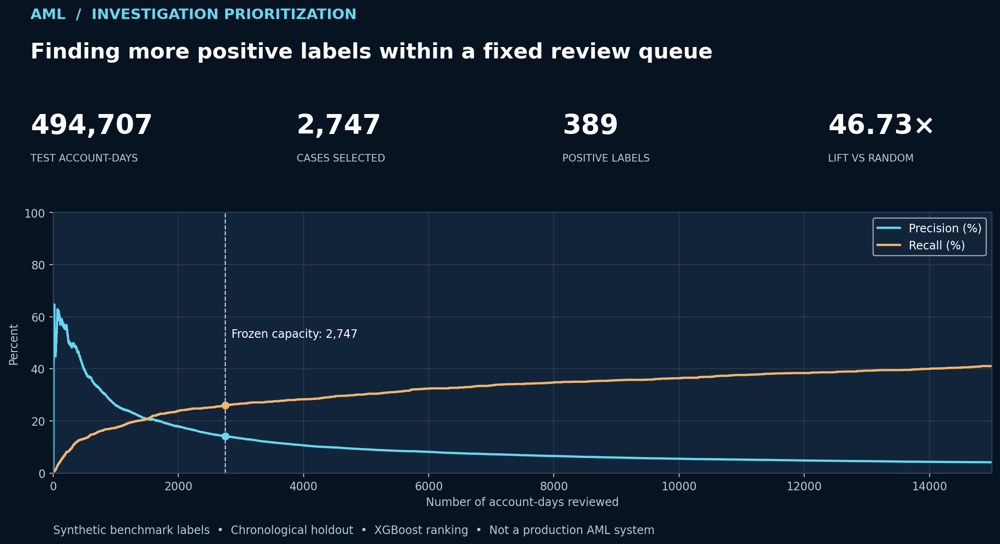

# AML Risk Prioritization | From Transactions to Investigation Decisions

**Can a machine-learning ranking model help investigators prioritize more relevant synthetic cases at a fixed review capacity?**

I built a supervised risk-ranking workflow using synthetic transaction-derived account-day data, chronological validation, XGBoost, and a review-capacity decision policy. The output is a ranked investigation queue—not an assertion that the selected accounts committed crimes.

**[Explore the interactive case study](https://mohammedmia1.github.io/AML_Data_Science_Project/)** · **[Read the notebook](notebooks/AML_Model_Development.ipynb)** · **[Evaluation and reproducibility](reports/MODEL_EVALUATION.md)**



## Key results · held-out test period

| Measure | Result |
|---|---:|
| Account-days evaluated | 494,707 |
| Account-days selected | 2,747 (0.555%) |
| Positive synthetic labels captured | **389** |
| Precision among selected | **14.16%** |
| Recall of test positives | **25.95%** |
| Lift versus random review | **46.73×** |
| ROC-AUC | 0.8523 |
| PR-AUC (average precision) | 0.1214 |

**What this means:** reviewing about 0.56% of the held-out account-days captured about 26% of synthetic positive labels. The 46.73× lift compares the selected queue's positive-label concentration with random selection at the same review capacity. It does not quantify financial savings or actual criminal detection.

## Method

1. **Represent activity:** aggregate synthetic transactions to account-day features using the [SQL engineering pipeline](sql/AML_Portfolio_Pipeline.sql).
2. **Avoid look-ahead:** train on September 1–6, validate on September 7–8, and evaluate on September 9–10, 2022.
3. **Model ranking:** compare a logistic regression baseline and XGBoost during development; the final saved model uses the documented XGBoost configuration.
4. **Freeze capacity:** translate a 2,500-case validation queue to the same proportional test review capacity.
5. **Evaluate the decision:** report precision, recall, lift, ROC-AUC, and PR-AUC, not accuracy alone.

## Reproduce

Install the pinned versions in `requirements.txt`. Place the exact `aml_modeling_dev.tsv` in `data/local/` (see [data provenance](data/README.md)). Then:

```bash
python src/run_canonical.py
python tests/check_artifacts.py
```

The script writes the model, predictions, metrics, and capacity curve to `artifacts/`. The published model and computed metrics are in `models/` and `reports/`. The notebook explains the analytical choices and executes the same canonical pipeline. The source TSV is not committed due to size.

## Explore the results

The [interactive case study](https://mohammedmia1.github.io/AML_Data_Science_Project/) lets you vary investigation capacity and inspect the trade-off between precision and recall. Its numbers are computed from the canonical held-out prediction ranking. The optional [Tableau dashboard companion](tableau/AML_Investigation_Prioritization_Dashboard.twbx) is a working Tableau Public workbook using the canonical evaluation; visual refinements can be made without altering the trained model. The scored Tableau-ready CSV is generated locally rather than committed. Tableau visual design can be refined independently without changing the model or source-of-truth metrics.

## Portfolio components

- **Model:** frozen XGBoost classifier, trained on temporal development records; serialized in `models/`.
- **Engineering:** MySQL account-day transformation documented in `sql/` (not independently raw-data-reexecuted in this repository).
- **Analysis:** primary notebook and runnable `src/run_canonical.py`.
- **Validation:** `python tests/check_artifacts.py` and GitHub Actions validation of public metrics, chart curves, and notebook structure.
- **Visualization:** interactive case study plus optional Tableau Public workbook companion.

## Limitations

All transactions and labels are synthetic. The test covers two days, scores are not proven calibrated probabilities, and no real investigator costs or operational outcomes were measured. See [evaluation details](reports/MODEL_EVALUATION.md).
